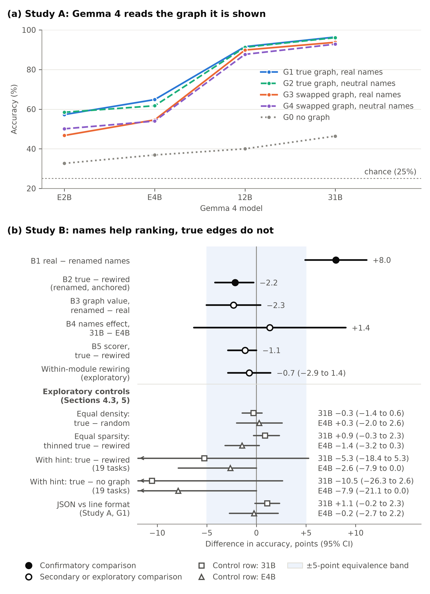

# Gemma 4 can read call graphs, but names, not edges, help it rank bug candidates

This repository holds the code, data, pre-registration and run files of the paper with that title, a writeup in Kaggle's [Gemma 4 Developer Agent Paper Track](https://www.kaggle.com/competitions/gemma-4-developer-agent-paper) (November 2026). Author: Zaeem Khan. Code and checks were built with an AI coding assistant (Claude Code); decisions are the author's.

## What the paper found

Two pre-registered studies ran Gemma 4 (E2B, E4B, 12B and 31B, Q4_0 files) with one forward pass and thinking off.

- **Study A: Gemma 4 reads the call graph it is shown.** On 640 call-graph questions from 32 Python repositories, 31B answers 96.4% with the true graph and 46.4% with no graph. After an edge swap that contradicts the real code, 31B still follows the shown graph (93.8%). Where the models' prior knowledge of the edges is weak, real names do not change how edges are read: the interaction is +0.5 points, equivalent to zero within ±5 points.
- **Study B: names help ranking, true edges do not.** On 371 bug-localization tasks from the competition and SWE-bench Lite, with no graph shown, real identifiers add 8.0 points of top-1 accuracy over renamed ones (95% CI 4.9 to 11.1). With identifiers renamed, on the 174 tasks that name a function unambiguously, the true call graph scores 2.2 points below a degree-preserving rewired copy (95% CI −4.2 to −0.3, Holm p = 0.0498). That result is borderline, and the pre-registration predicted a gain.



## Reprint the paper's tables

Python 3 is enough; nothing needs installing. Run the script from the repository root. From any other folder it finds no run files and stops with a `ZeroDivisionError`.

```bash
git clone https://github.com/zaeem-rafiq/gemma4-names-vs-edges.git
cd gemma4-names-vs-edges
python3 reproduce_from_runs.py
```

The first line it prints is `Study A: 19200 rows from 4 files`. Tables 1 and 3 and the A1, B1 and B2 estimates follow. `notebooks/names_vs_edges_recompute.ipynb` recomputes the same numbers and the letter-logit analysis, and checks both report hashes.

## Check the pre-registration

The SHA-256 of each manifest was posted on the competition forum before the confirmatory runs ([topic 757402](https://www.kaggle.com/competitions/gemma-4-developer-agent-paper/discussion/757402)). This command recomputes the hash of the Study B addendum from the 188 files it lists:

```bash
PYTHONPATH=src python3 -m ngraph.commit verify --manifest prereg/MANIFEST_prereg-v1.1.txt --expect 86312d42c3cda411e851bdfbfa5a595d4f9bc35334e595167ead0bff3c4afa4c
```

The last entry of its output is `"ok": true`. Files added after the freeze appear under `not_listed` and do not fail the check.

For the first freeze, unpack `frozen/prereg-v1.0.tar.gz` into an empty folder and run the same command there with `prereg/MANIFEST_prereg-v1.0.txt` and the hash `c4d82769f7607766066ffa8986dd16576499dc7b835cf3d94b8f9a9766be5ced`.

## Two commands that the root README writes differently

The root [README.md](https://github.com/zaeem-rafiq/gemma4-names-vs-edges/blob/main/README.md) is the package README as it was frozen with the pre-registration on 10 November 2026, before Study B was scored. The manifest hashes it, so it stays byte-identical and its status paragraph is out of date. [STATUS.md](https://github.com/zaeem-rafiq/gemma4-names-vs-edges/blob/main/STATUS.md) has the current state. Two of its commands need a different form on this tree.

**Tests.** One test, `test_package_code_sha256_is_current`, compares the frozen `CODE_SHA256.txt` with the current tree. It fails on any tree that holds files added after the freeze, as this one does. The tests need the packages in `requirements.txt`; the released results used Python 3.13.18 and 3.14.8. Set the environment variables of the root README's section 1, then run:

```bash
python -m pytest -q tests --deselect tests/test_commit.py::test_package_code_sha256_is_current
```

The expected result is `280 passed, 1 deselected` when llama-cpp-python is installed, as the root README's setup section describes. Without it, the 15 tests that need it are skipped and the result is `265 passed, 15 skipped, 1 deselected`. The root README adds that one more test is skipped where `sha256sum` is not on the PATH.

**Study A analysis.** The run files are in `runs/studyA/`, not in `runs/`. The command needs the packages in `requirements.txt`, and its output path leaves the released `runs/studyA/studyA_report.json` untouched:

```bash
PYTHONPATH=src python -m ngraph.analysis --runs runs/studyA/studyA_E2B.jsonl runs/studyA/studyA_E4B.jsonl runs/studyA/studyA_12B.jsonl runs/studyA/studyA_31B.jsonl --manifest data/repos_manifest.json --items-dir data/items --out /tmp/studyA_report_check.json
```

The Study B report cannot be recomputed from this repository alone, because the task files built from the competition data and SWE-bench Lite are not redistributed. `data/studyb/README.md` gives their SHA-256 and the rebuild commands.

## Figures

```bash
uv run --with matplotlib==3.11.2 python fig/fig1.py
uv run --with matplotlib==3.11.2 python fig/fig2.py
```

Both scripts read their values from the released result files and write `fig/figure1.png` and `fig/figure2.png`. Without uv, install matplotlib 3.11.2 and run the scripts with `python`.

## Where things are

| Path | What it holds |
|---|---|
| `prereg/` | The pre-registration, its open items and both manifests |
| `frozen/` | The two snapshot archives behind the posted hashes |
| `runs/studyA/`, `runs/studyB/` | Run files, logs and the two reports |
| `exploratory/` | The exploratory controls of 11 November, which were not pre-registered |
| `data/items/` | The Study A questions. The 640 scored ones belong to the 32 repositories with the role `confirmatory` in `data/repos_manifest.json` |
| `src/ngraph/`, `tests/` | The package and its tests |
| `STATUS.md`, `RELEASE_NOTES.md` | The current state, the paper's tables mapped to files, and what the release leaves out |

The code and text of this package are under the Apache License 2.0.
